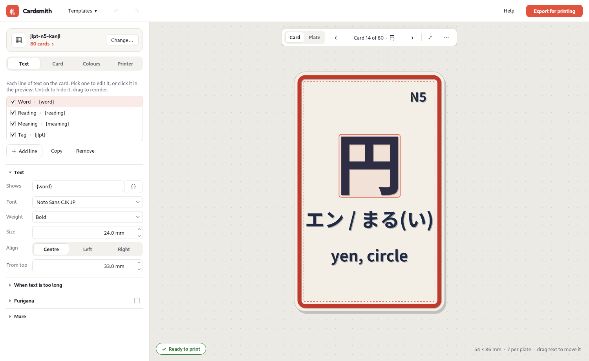
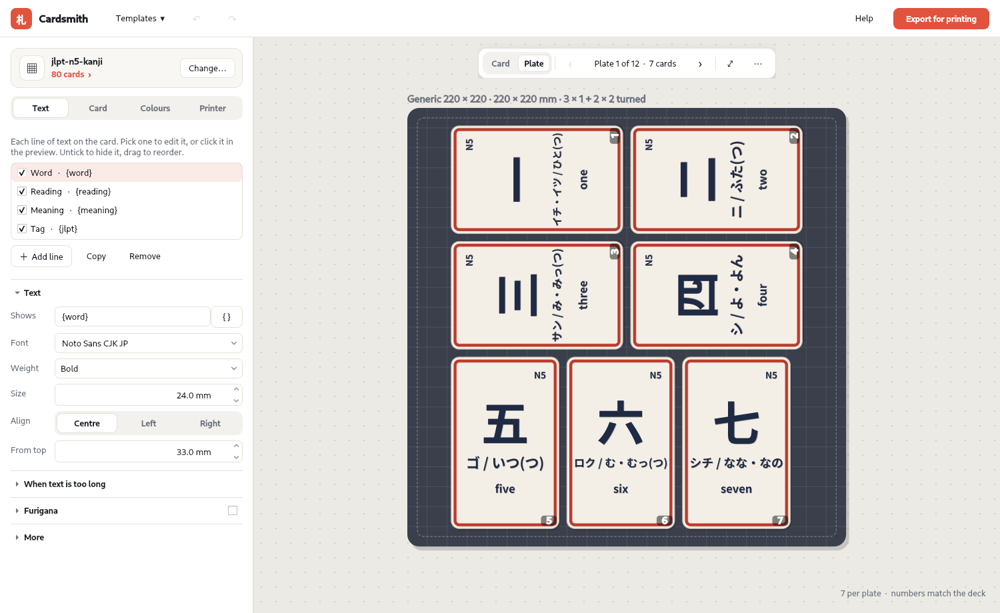
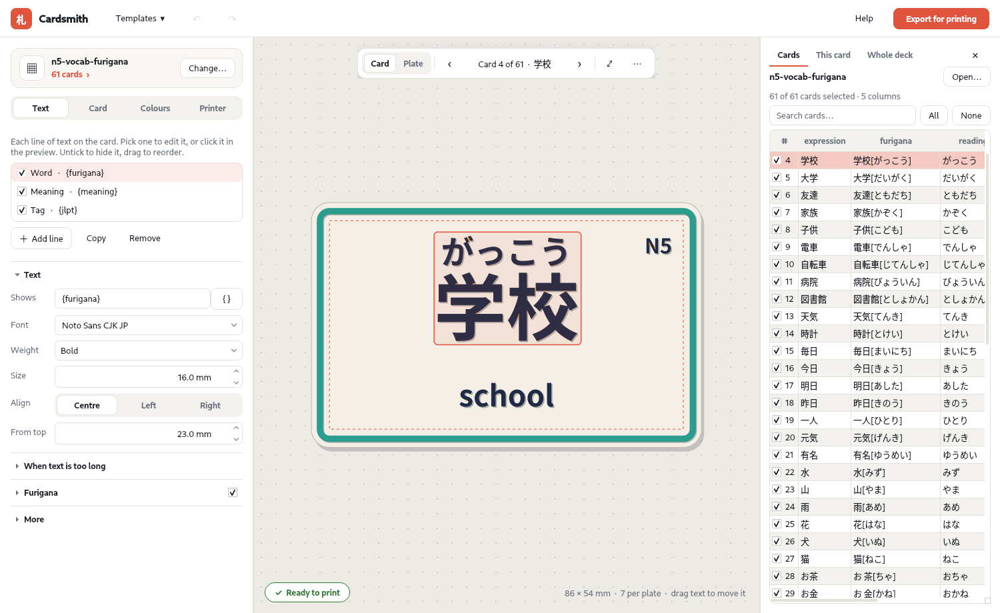
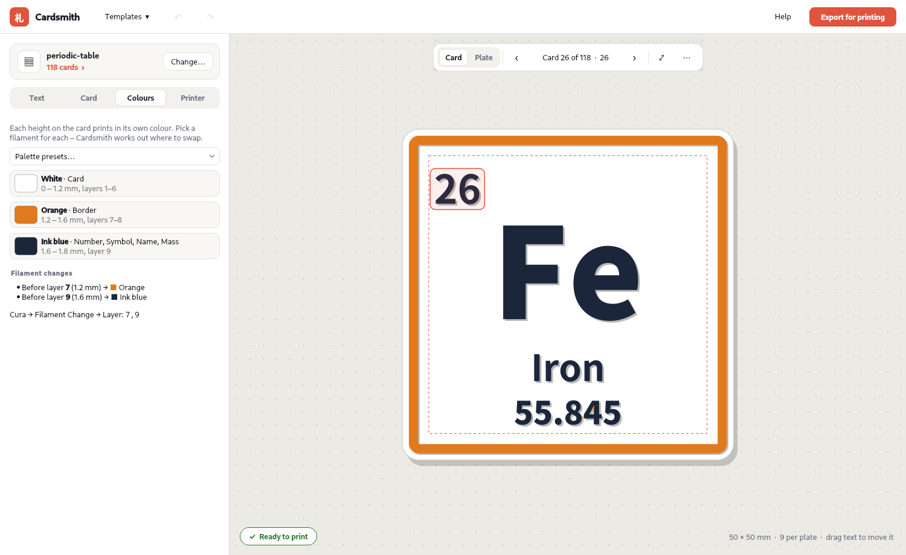
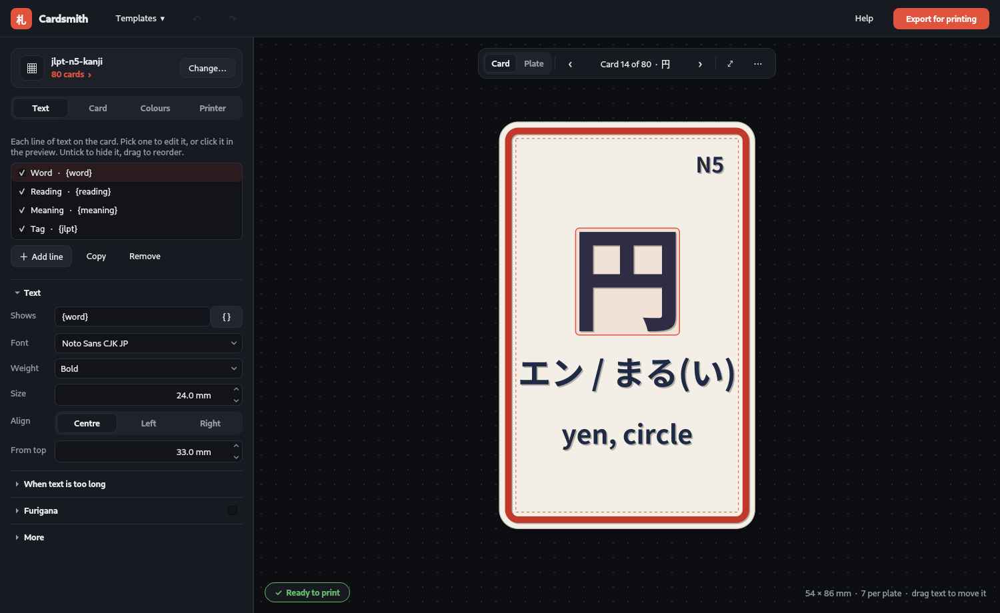

<p align="center">
  
</p>

<h1 align="center">Cardsmith</h1>

<p align="center">
  <b>Spreadsheet in, multi-colour 3D-printed flashcards out.</b><br>
  Kanji, vocab, periodic tables, anything with columns.
</p>

<p align="center">
  <a href="https://github.com/Jackicus/cardsmith/actions/workflows/ci.yml"></a>
  
  
</p>



## How it works

1. **Open a spreadsheet**: CSV, TSV, JSON or an Anki export.
2. **Design the card**: pick a template, drag the text where you want it, choose your colours.
3. **Export for printing**: plates packed onto your bed, ready for Cura, with the filament-change
   layers worked out. One nozzle, several colours.

<table>
<tr>
<td width="50%"></td>
<td width="50%"></td>
</tr>
<tr>
<td align="center">Cards packed to fit the most per plate</td>
<td align="center">Furigana above the kanji</td>
</tr>
<tr>
<td></td>
<td></td>
</tr>
<tr>
<td align="center">Not just Japanese</td>
<td align="center">Dark mode</td>
</tr>
</table>

## Highlights

- **Live preview** from your real fonts. What you see is what prints.
- **Multi-colour on a single nozzle.** Each height prints in its own colour, and Cardsmith gives you
  the exact layers to swap at. AMS / MMU users get per-colour files too.
- **Print checks** flag text that's too thin or too tight for your nozzle before you waste filament.
- **Five templates** to start from, plus example decks in [`examples/`](examples).
- **Command line** for batch builds: `cardsmith build deck.tsv -t kanji -p "Bambu Lab A1"`.

## Install

Needs Python 3.11+. For Japanese text, install
[Noto Sans CJK JP](https://github.com/notofonts/noto-cjk) (`fonts-noto-cjk` / `noto-fonts-cjk`).

```sh
git clone https://github.com/Jackicus/cardsmith && cd cardsmith
python -m venv .venv && .venv/bin/pip install -e ".[gui]"
.venv/bin/cardsmith          # opens the app with a sample kanji deck
```

Something not right? `cardsmith doctor` checks your fonts, the app and Cura.

## Learn more

The **[guide](docs/guide.md)** covers the app step by step, how the colours work, Cura setup,
templates, the command line and printing tips. Want to help? See
[CONTRIBUTING.md](CONTRIBUTING.md).

MIT licensed.
