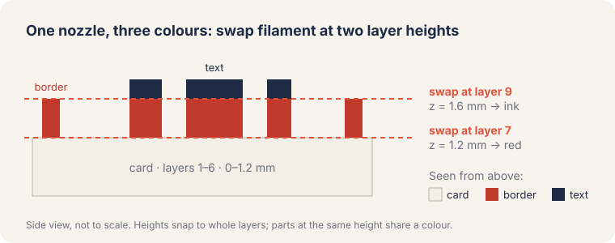
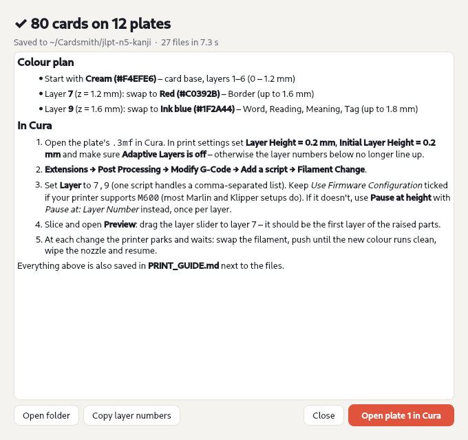

# Cardsmith guide

Everything beyond the [README](../README.md): the app step by step, how the colours work, slicer
setup, templates, the command line and printing tips.

- [Using the app](#using-the-app)
- [How the colours work](#how-the-colours-work)
- [Command line](#command-line)
- [Templates](#templates)
- [Printing tips](#printing-tips)
- [How it works](#how-it-works)

## Using the app

1. **Change…** on the deck card (top left) opens your spreadsheet. The app starts with the bundled
   JLPT N5 kanji deck. Click **80 cards ›** to see the list and untick cards you don't want to print.
2. **Templates** (top bar) has starting points: *Kanji flashcard*, *Vocab with furigana*, *Minimal*,
   *Element tile* and *Language pair*. The [`examples/`](../examples) folder has decks to go with them.
3. **Text**: each line of raised text. Set it to `{column}` with the **{ }** button, then pick a
   font and size. Drag it into place in the preview.
4. **Card**: size (presets included), corner radius and the raised border.
5. **Colours**: pick a filament colour per height band.
6. **Printer**: your bed size and layer heights. Save it as a profile. Switch the preview to
   **Plate** to see how the cards pack.
7. **Export for printing** and drop the plates into Cura.

Shortcuts: **Page Up / Page Down** step through cards, **Ctrl+O** opens a deck, **Ctrl+Z / Ctrl+Shift+Z**
undo and redo, **Ctrl+E** exports, **Esc** closes the drawer.

## How the colours work



The card prints flat, from the bottom up. Swap filament at the first layer of each band and, seen
from above, the card, the border and the text each come out a different colour. To give two things
different colours, give them different heights. The **Colours** tab shows the bands, and the
exported `PRINT_GUIDE.md` lists the layers.

> The layer numbers were checked by slicing an exported plate with Cura 5.13's own CuraEngine.
> The card ends at layer 6 (1.2 mm), the first raised layer is 7 and the text-only top is 9,
> which is exactly the `7,9` Cardsmith gives.

### Filament changes in Cura



1. Open `plates/plate_01.3mf`. Set **Layer Height** and **Initial Layer Height** to match the
   Printer tab, and turn **Adaptive Layers** off.
2. Go to **Extensions → Post Processing → Modify G-Code → Add a script → Filament Change**.
3. Enter the layers, e.g. `7,9`. The export window has a **Copy layer numbers** button.
4. Slice and check **Preview**: layer 7 should be the first layer of the raised parts.

If your firmware has no `M600`, use **Pause at height** (by layer number) instead.
PrusaSlicer, OrcaSlicer and Bambu Studio open the same files; add the colour changes with the **+**
on their layer slider.

## Command line

```sh
cardsmith build examples/japanese/jlpt-n5-kanji.tsv -t kanji -p "Prusa MK4" -o out/kanji
cardsmith build deck.csv -t my-template.toml --bed 235x235 --singles    # + one STL per card
cardsmith check deck.csv -t my-template.toml                            # layout & print problems
cardsmith printers | templates | fonts --ja
cardsmith doctor                                                        # check fonts, the app and Cura
```

If something looks wrong (blank text, the app won't start, "Open in Cura" is greyed out), run
`cardsmith doctor` first. It lists what's installed and how to fix anything missing.

## Templates

Templates are plain TOML, so they're easy to share, version and generate:

```toml
name = "Kanji flashcard"
palette = ["#F4EFE6", "#C0392B", "#1F2A44"]   # colour per height band, from the card up

[card]
width = 54.0
height = 86.0
thickness = 1.2
corner_radius = 4.0
padding = 3.5

[border]
width = 1.4
inset = 1.2
height = 0.4

[[slots]]
name = "Word"
text = "{word}"
font = "Noto Sans CJK JP:Bold"
size = 24.0        # em size in mm
height = 0.6       # raised above the card
y = 33.0           # centre, mm from the top edge
fit = "shrink"     # or "wrap" (with max_lines) or "none"
min_size = 9.0
```

Slot text can mix fields and fixed text, with filters:

| Write | Shows |
|---|---|
| `{word}` | the *word* column |
| `{furigana\|kanji}` | `漢字[かんじ]` → 漢字 |
| `{furigana\|kana}` | `漢字[かんじ]` → かんじ |
| `{meaning\|first}` | first item of `a; b; c` |
| `{type\|upper}` | NOUN |
| `{#}` · `{##}` | card number · total |

## Printing tips

- Bold or Black weights print best. With a 0.4 mm nozzle, keep secondary text at 4–5 mm or bigger.
- A base of 1.2 mm with 0.4–0.6 mm of relief gives sturdy cards without wasting filament.
- A textured PEI sheet gives the cards a lovely matte back.
- Turning on ironing for the top surface only smooths the raised tops.

## How it works

Fonts → glyph outlines (fontTools) → 2D layout and print checks (shapely) → watertight solids
(manifold3d) → STL / 3MF. There's no CAD package in the loop: the 80-card N5 deck builds into 12
plates in about 15 seconds. The engine has no GUI dependencies. The PySide6 app sits on top of it, and the core is
covered by a pytest suite. See [CONTRIBUTING.md](../CONTRIBUTING.md).

## Ideas for later

Double-sided cards (print the backs as a second job), engraved or inlaid text for single-colour
printers, QR codes linking to audio, and more templates. PRs welcome!

## Example decks

The example decks are free to use. Kanji readings and meanings were compiled for learners, so please
open an issue if you spot a mistake.
